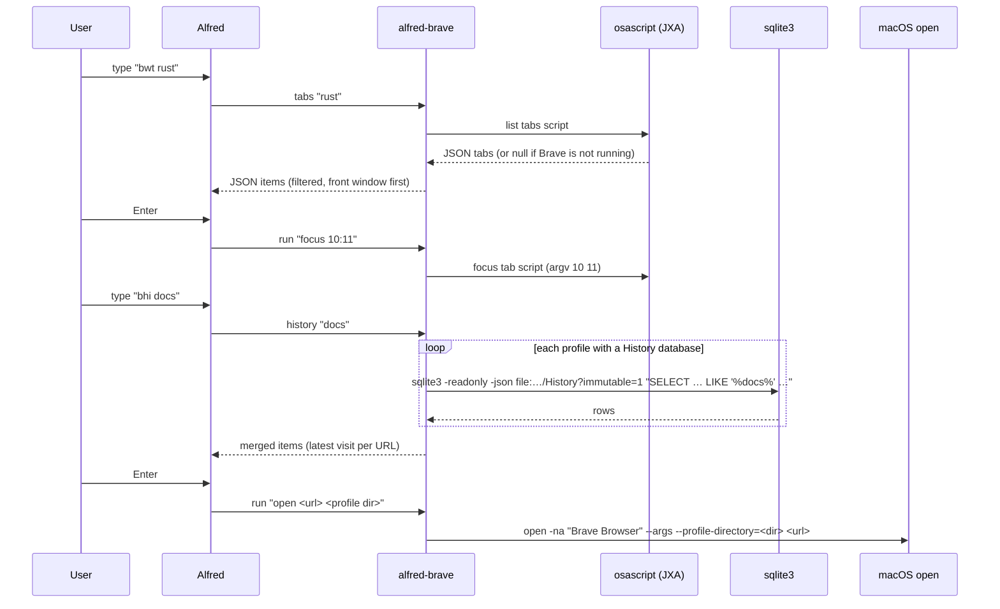

# Architecture

## Overview

The workflow is a single Rust binary, `alfred-brave`, with one subcommand per
object in the Alfred workflow graph:

| Subcommand                     | Alfred object                   | Keyword | Responsibility |
| ------------------------------ | ------------------------------- | ------- | -------------- |
| `alfred-brave window [query]`  | Script Filter                   | `bw`    | Describe the window(s), URL or search the query asks for (URL/search: ↩ tab in the current window, ⌥ new window). |
| `alfred-brave profiles [query]`| Script Filter                   | `bwp`   | List Brave profiles from `Local State`. |
| `alfred-brave tabs [query]`    | Script Filter                   | `bwt`   | List open tabs, filtered by the query. |
| `alfred-brave history [query]` | Script Filter                   | `bhi`   | Search the history of every profile. |
| `alfred-brave current`         | Script Filter                   | `bwc`   | Offer to copy the current tab URL. |
| `alfred-brave private-tab`     | Script Filter                   | `btp`   | Offer to reopen the current tab privately. |
| `alfred-brave run <arg>`       | Run Script (`action.script`)    | —       | Decode the selected item's `arg` and perform it. |

Every script filter is connected to the single Run Script, itself connected to
a Post Notification that shows whatever `run` prints (copies, closed tabs,
errors).

## The `arg` protocol

Script filter items do not carry raw data: their `arg` — and the `arg` of each
modifier (`mods`) — is an encoded [`Action`](../src/action.rs):
`"<verb> <payload>"`. `run` decodes it with `Action::parse` and performs it
with `action::execute`.

| Verb           | Payload                     | Effect |
| -------------- | --------------------------- | ------ |
| `window`       | `[url]`                     | New window, optionally on a URL. |
| `windows`      | `<count>`                   | `count` blank windows. |
| `private`      | `[url]`                     | New private window. |
| `tab`          | `<url>`                     | New tab in the front window. |
| `profile`      | `<dir>`                     | New window in a profile. |
| `profile-tab`  | `<dir>`                     | Current tab's URL in a new tab of the profile's current window. |
| `focus`        | `<windowId>:<tabId>`        | Select the tab and raise its window. |
| `copy`         | `<url>`                     | Copy the URL. |
| `copy-md`      | `<url> <title>`             | Copy `[title](url)`. |
| `edit`         | `<url>`                     | Reopen Alfred on `bw <url>`. |
| `close-url`    | `<url>`                     | Close every tab showing that URL. |
| `open`         | `<url> <dir>`               | Open a history entry in a new tab of its profile's current window. |
| `move-private` | `<windowId>:<tabId> <url>`  | Private window on `url`, then close the tab. |

Fields are ordered so that only the last one may contain spaces (titles,
profile directories such as `Profile 1`); URLs and ids never do. A round-trip
test covers every verb.

Each script filter declares connections for every modifier used
(<kbd>⌘</kbd>, <kbd>⌥</kbd>, <kbd>⌃</kbd>, <kbd>⇧⌘</kbd>), all to the same Run
Script, so a modifier's `arg` always reaches `run`.

## Talking to Brave

- **JXA scripts** (`src/brave.rs`) are fixed constants; inputs travel as
  `argv`, never interpolated into source. Listing scripts check
  `running()` first and print `null` instead of launching Brave.
- **Profiles** cannot be targeted through AppleScript, so opening in a profile
  goes through Brave's `--profile-directory` flag via `open -na`. With a URL the
  flag set has no `--new-window`: Brave opens a new tab in that profile's
  current window (a window only if it has none). Without a URL, `--new-window`
  opens a blank window.
- **History**: Brave keeps each profile's `History` database locked. Opening it
  as an `immutable` SQLite URI with the system `sqlite3` avoids both the lock
  and a copy. The trade-off: visits not yet flushed to disk may be missing.
  Terms are pushed into SQL (`LIKE … ESCAPE '\'`, quotes doubled), so the whole
  history is searchable; results are merged across profiles keeping the most
  recent visit of each URL. One unreadable profile is skipped; an error is
  shown only if every profile failed.

## Design decisions

- **Everything is a pure function except one trait.** The only side-effecting
  boundary — spawning `osascript`, `sqlite3` and `open` — is
  `runner::CommandRunner` (`SystemRunner` in prod, `FakeRunner` in tests).
- **No `uid` on items**: Alfred would re-sort by its own usage knowledge.
  Filtering and ordering happen in Rust (`alfredfiltersresults = false`).
- **Script filters never hard-fail**: errors become an invalid Alfred item.
- **No configuration**: profiles are discovered, keywords are fixed (the
  `edit` action reopens Alfred on the `bw` keyword).
- **Move to private is ordered**: the private window opens first and the
  original tab is closed only if that succeeded.
